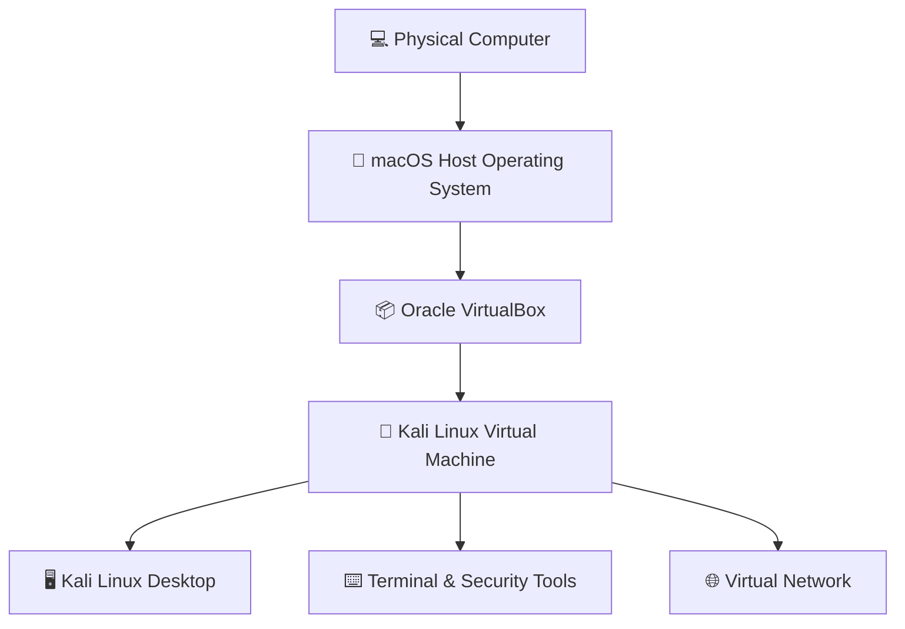

 <div align="center">

# 🛡️ CYBERSECURITY LAB ENVIRONMENT

### Virtual Lab Deployment & Configuration

**Building a controlled virtual environment for cybersecurity learning, Linux administration and ethical hacking practice.**

<br/>


---

### PROJECT INFORMATION

| Attribute | Details |
|:---|:---|
| **Project Title** | Cybersecurity Lab Environment Setup |
| **Training Program** | Networkwalks Cybersecurity |
| **Batch** | B084 |
| **Week** | Week 01 |
| **Host Operating System** | macOS |
| **Virtualization Platform** | Oracle VirtualBox |
| **Guest Operating System** | Kali Linux |
| **Documentation** | GitHub |

</div>

---

# 📑 Table of Contents

1. [Project Overview](#-01-project-overview)
2. [Project Objectives](#-02-project-objectives)
3. [Purpose and Scope](#-03-purpose-and-scope)
4. [Laboratory Architecture](#-04-laboratory-architecture)
5. [Hardware and Software Requirements](#-05-hardware-and-software-requirements)
6. [Laboratory Configuration](#-06-laboratory-configuration)
7. [Implementation and Setup Procedure](#-07-implementation-and-setup-procedure)
8. [Network Configuration](#-08-network-configuration)
9. [Testing and Verification](#-09-testing-and-verification)
10. [Troubleshooting](#-10-troubleshooting)
11. [Technical Concepts Learned](#-11-technical-concepts-learned)
12. [Skills and Knowledge Gained](#-12-skills-and-knowledge-gained)
13. [Security and Ethical Considerations](#-13-security-and-ethical-considerations)
14. [Project Screenshots](#-14-project-screenshots)
15. [Tools and References](#-15-tools-and-references)
16. [Author Information](#-16-author-information)

---

# 🔐 01. Project Overview

This project focuses on designing and establishing a virtual cybersecurity laboratory using **Oracle VirtualBox and Kali Linux**, hosted on a macOS environment.

The laboratory provides a dedicated environment for learning cybersecurity concepts, understanding Linux operating systems, exploring network configurations, and preparing for practical security assessments.

By using virtualization technology, a separate operating system can run inside the host computer without requiring a separate physical machine.

The main goal is to establish a flexible and controlled environment that can support future cybersecurity exercises, practical demonstrations, and ethical hacking experiments.

### Project Highlights

- Virtual machine deployment and configuration.
- Kali Linux installation and environment preparation.
- Virtual network configuration.
- Linux command-line interaction.
- Network connectivity testing.
- Preparation for future cybersecurity exercises.

---

# 🎯 02. Project Objectives

The primary objectives of this project are:

- Understand virtualization technology and its application in cybersecurity.
- Install and configure Oracle VirtualBox on macOS.
- Deploy Kali Linux as a guest operating system.
- Allocate appropriate resources to the virtual machine.
- Understand virtual network adapter configurations.
- Configure and verify network connectivity.
- Explore the Kali Linux desktop and terminal environment.
- Perform basic Linux system administration tasks.
- Establish a reusable environment for future security exercises.
- Document the complete implementation process using screenshots.

---

# 🛡️ 03. Purpose and Scope

The purpose of this laboratory is to provide a practical learning environment where cybersecurity concepts can be explored in a controlled manner.

### Intended Learning Activities

| Area | Description |
|:---|:---|
| Linux Administration | Basic Linux commands and system management |
| Network Fundamentals | IP addressing, gateways and connectivity |
| Network Reconnaissance | Understanding network discovery |
| Security Assessment | Learning vulnerability assessment concepts |
| Virtualization | Managing and configuring virtual machines |
| Ethical Hacking | Practicing authorized security testing |

### Project Scope

This initial project focuses on establishing the virtual environment.

Advanced penetration testing, vulnerability exploitation, and additional target-machine deployment are considered future learning activities rather than assumed completed tasks.

---

# 🏗️ 04. Laboratory Architecture

The laboratory follows a host-and-guest virtualization architecture.



### Architecture Explanation

1. **Physical Computer:** Provides the hardware resources.
2. **macOS:** Acts as the primary host operating system.
3. **Oracle VirtualBox:** Provides the virtualization platform.
4. **Kali Linux:** Runs as an independent guest operating system.
5. **Virtual Network:** Provides network connectivity according to the configured VirtualBox network mode.

This architecture makes it possible to experiment with a separate operating system while maintaining the primary macOS environment.

---

# 💻 05. Hardware and Software Requirements

### Hardware Requirements

| Component | Description |
|:---|:---|
| Host Computer | MacBook / Mac computer |
| Processor | To be documented |
| RAM | To be documented |
| Storage | Available disk space for virtualization |
| Internet | Required for downloading installation resources |

### Software Requirements

| Software | Purpose |
|:---|:---|
| macOS | Host operating system |
| Oracle VirtualBox | Virtualization platform |
| Kali Linux | Cybersecurity guest operating system |
| GitHub | Project documentation and version control |

---

# ⚙️ 06. Laboratory Configuration

The following table records the laboratory configuration.

| Configuration | Value |
|:---|:---|
| Host Operating System | macOS |
| Virtualization Software | Oracle VirtualBox |
| Guest Operating System | Kali Linux |
| VirtualBox Version | To be confirmed |
| Kali Linux Version | To be confirmed |
| Allocated RAM | To be confirmed |
| Virtual CPU Cores | To be confirmed |
| Virtual Disk Size | To be confirmed |
| Network Adapter Mode | To be confirmed |
| IP Address | To be confirmed |
| Default Gateway | To be confirmed |

> **Note:** Configuration values should be updated using the actual settings displayed in VirtualBox and Kali Linux.

---

# 🪜 07. Implementation and Setup Procedure

This section documents the stages involved in establishing the cybersecurity laboratory.

## Step 1. Prepare the Host Environment

The first stage involves preparing the macOS computer for virtualization.

Activities include:

- Checking the available storage space.
- Checking the processor architecture.
- Checking available system memory.
- Preparing the host environment for VirtualBox installation.

## Step 2. Install Oracle VirtualBox

Oracle VirtualBox serves as the hypervisor used to create and manage virtual machines.

The software is obtained from its official download page.

Official resource: https://www.virtualbox.org/wiki/Downloads

## Step 3. Obtain Kali Linux

Kali Linux is the guest operating system selected for the cybersecurity laboratory.

The installation image or supported virtual machine package should be obtained from the official Kali Linux website.

Official resource: https://www.kali.org/get-kali/

## Step 4. Create or Import the Virtual Machine

The Kali Linux virtual machine is prepared inside Oracle VirtualBox.

The configuration process includes:

- Creating or importing the virtual machine.
- Selecting the appropriate operating system architecture.
- Allocating memory resources.
- Configuring virtual processors.
- Allocating virtual disk storage.
- Configuring the virtual network adapter.

## Step 5. Start and Configure Kali Linux

After preparing the virtual machine, Kali Linux is started.

The initial configuration involves:

- Accessing the Kali Linux desktop.
- Checking system information.
- Exploring the terminal.
- Confirming that the operating system starts correctly.
- Reviewing available system resources.

## Step 6. Configure Virtual Networking

The network adapter is configured according to the laboratory requirements.

The network configuration is then checked from inside Kali Linux.

## Step 7. Perform Initial Verification

Basic system and network commands are executed to confirm that the virtual machine is operating correctly.

## Step 8. Prepare a Recovery Point

If supported and available, a clean virtual machine snapshot can be created after successful initial configuration.

This provides a recovery point before future experiments.

---

# 🌐 08. Network Configuration

Networking is an important part of a cybersecurity laboratory.

VirtualBox provides different networking modes, including:

| Network Mode | Purpose |
|:---|:---|
| NAT | Provides outbound connectivity through the host |
| NAT Network | Allows communication between VMs on the same NAT Network |
| Bridged Adapter | Connects the VM to a physical network |
| Host-only Adapter | Creates communication between host and virtual machines |
| Internal Network | Allows communication between VMs on an isolated virtual network |

### Network Configuration Details

The actual network configuration used in this project should be documented below.

```text
Virtualization Platform: Oracle VirtualBox

Guest Operating System: Kali Linux

Network Adapter Mode: [UPDATE]

IP Address: [UPDATE]

Subnet Mask: [UPDATE]

Default Gateway: [UPDATE]

DNS Server: [UPDATE]
```

### Network Verification Commands

```bash
# Display network interfaces
ip a

# Display routing information
ip route

# Display DNS configuration
cat /etc/resolv.conf

# Test connectivity to an authorized destination
ping -c 4 1.1.1.1
```

---

# 🔎 09. Testing and Verification

Testing helps establish whether the virtual environment is functioning as expected.

| Test | Command / Method | Purpose |
|:---|:---|:---|
| System Information | `uname -a` | Check operating system information |
| IP Configuration | `ip a` | Display network interfaces |
| Routing Information | `ip route` | Check network routes |
| DNS Configuration | `cat /etc/resolv.conf` | Inspect DNS configuration |
| Connectivity | `ping -c 4 1.1.1.1` | Test external IP connectivity |
| Virtual Machine | VirtualBox Manager | Verify VM operation |

### Verification Results

Update this table after performing the tests.

| Verification | Status |
|:---|:---|
| Kali Linux boots successfully | Pending |
| VirtualBox VM configuration | Pending |
| Network interface detected | Pending |
| IP configuration verified | Pending |
| Network connectivity tested | Pending |

---

# 🐞 10. Troubleshooting

Virtualization and operating system configuration can introduce technical challenges.

The following table provides a place to document actual issues encountered during implementation.

| Problem | Investigation / Solution |
|:---|:---|
| Virtual machine fails to start | Check VirtualBox compatibility and system architecture |
| Kali Linux installation problems | Verify the downloaded installation image |
| Insufficient memory | Review the VM memory allocation |
| Network connectivity failure | Check the virtual adapter and network configuration |
| DNS resolution failure | Inspect DNS configuration and connectivity |

### Troubleshooting Documentation

For every problem encountered, document:

1. The problem description.
2. The error message or observed behavior.
3. The investigation performed.
4. The solution implemented.
5. The final verification result.

---

# 🧠 11. Technical Concepts Learned

This project introduces several important concepts in cybersecurity and IT infrastructure.

### 1. Virtualization Technology

Virtualization allows multiple operating system environments to operate on a single physical computer.

### 2. Host and Guest Operating Systems

The host is the primary operating system running on the physical computer, while the guest operates inside a virtual machine.

### 3. Linux Environment

Kali Linux provides an environment for learning Linux administration and exploring cybersecurity tools.

### 4. Virtual Networking

Virtual networking makes it possible to connect virtual machines using different network configurations.

### 5. Network Addressing

IP addresses, subnet masks, gateways, and DNS are important components of network communication.

### 6. Laboratory Isolation

A properly configured virtual laboratory helps separate cybersecurity experiments from the normal computing environment.

---

# 🚀 12. Skills and Knowledge Gained

The project supports the development of practical technical skills in:

- Virtual machine installation and management.
- macOS and virtualization environments.
- Kali Linux operating system fundamentals.
- Linux terminal commands.
- Network configuration and troubleshooting.
- Basic networking concepts.
- Technical documentation.
- Cybersecurity laboratory preparation.

---

# 🔐 13. Security and Ethical Considerations

This laboratory is established for educational purposes and authorized cybersecurity practice.

All security-testing activities must follow applicable laws and ethical guidelines.

The following principles apply:

- Only test systems you own or have explicit authorization to assess.
- Do not perform unauthorized network scanning.
- Keep experimental environments appropriately isolated.
- Protect sensitive information and credentials.
- Maintain recovery points before risky experiments.
- Use cybersecurity knowledge responsibly.

**Cybersecurity is about protecting systems, identifying weaknesses responsibly, and improving digital security.**

---

# 📸 14. Project Screenshots

Screenshots provide visual evidence of the actual implementation process.

The following are the recommended screenshot locations.

### Screenshot 01 – VirtualBox Installation / Overview


### Screenshot 02 – Kali Linux Virtual Machine Configuration


### Screenshot 03 – Kali Linux Desktop Environment


### Screenshot 04 – Network Configuration


### Screenshot 05 – Terminal Verification


### Screenshot 06 – Successful Virtual Machine Operation


> Replace these image paths with your actual screenshots. Only include evidence of configurations and tests you have completed.

---

# 🧰 15. Tools and References

### Tools Used

| Tool | Official Website |
|:---|:---|
| Oracle VirtualBox | https://www.virtualbox.org/ |
| Kali Linux | https://www.kali.org/ |
| GitHub | https://github.com/ |

### Learning Resources

- [Kali Linux Documentation](https://www.kali.org/docs/)
- [VirtualBox User Manual](https://www.virtualbox.org/manual/)
- [Linux Manual Pages](https://man7.org/linux/man-pages/)

---

# 👨‍💻 16. Author Information

**Emmanuel**

Cybersecurity Trainee | Networkwalks

**Batch:** B084

**Project:** Week 01 – Cybersecurity Lab Environment Setup

**GitHub:** [@elninja336](https://github.com/elninja336)

---

<div align="center">

### 🔐 LEARN • BUILD • SECURE • REPEAT

**NETWORKWALKS CYBERSECURITY | BATCH B084**

*Building practical cybersecurity knowledge, one laboratory at a time.*

</div>

---

> **Disclaimer:** This repository documents an educational cybersecurity laboratory project. All tools and techniques are intended for authorized and ethical use only.

